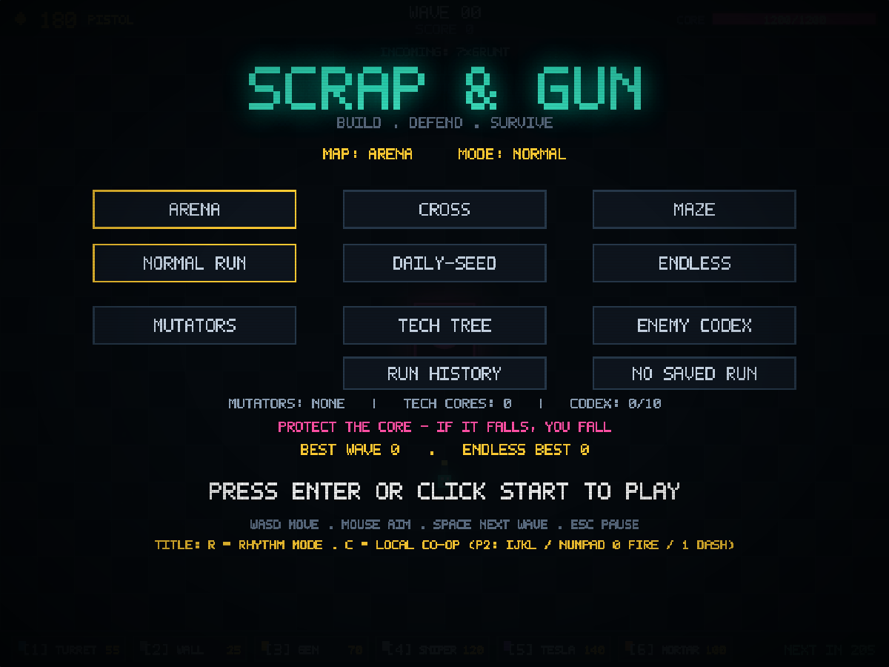
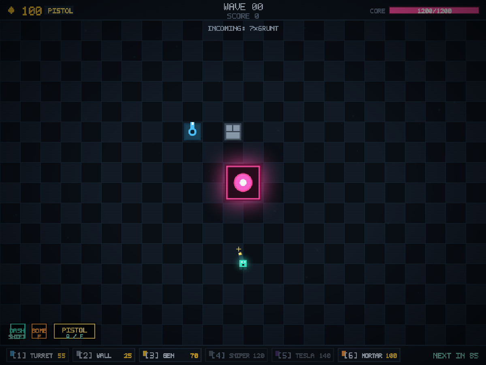
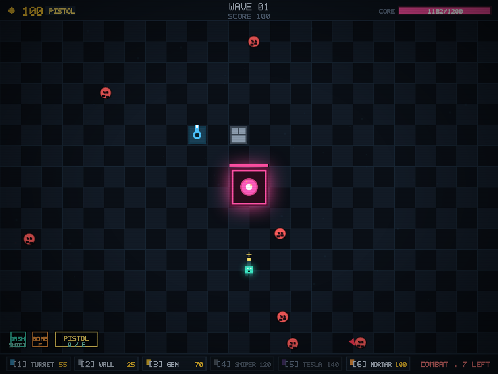
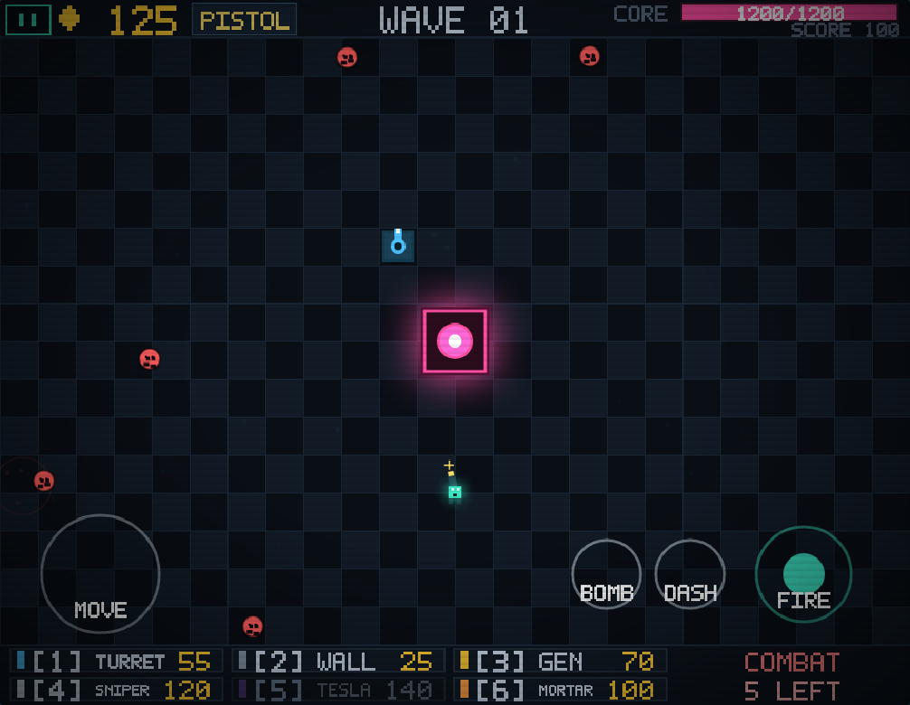

<div align="center">

# SCRAP &amp; GUN

### Build. Defend. Survive.

A retro pixel-art arena defense shooter with tactical construction, escalating enemy waves, persistent upgrades, roguelite drafts, bosses and local co-op.

**[▶ Play in your browser](https://drsamonline.github.io/Scrap-and-Gun/play/)** · **[Landing page](https://drsamonline.github.io/Scrap-and-Gun/)** · **[Releases](https://github.com/drsamonline/Scrap-and-Gun/releases)**

[](https://drsamonline.github.io/Scrap-and-Gun/play/)
[](https://drsamonline.github.io/Scrap-and-Gun/)
[](https://github.com/drsamonline/Scrap-and-Gun/releases)

[](LICENSE)


</div>

---

## Play it

**[▶ Play in your browser →](https://drsamonline.github.io/Scrap-and-Gun/play/)** — no install, no build step.

| | |
| --- | --- |
| **Landing page** | [drsamonline.github.io/Scrap-and-Gun](https://drsamonline.github.io/Scrap-and-Gun/) |
| **Live demo (the game)** | [drsamonline.github.io/Scrap-and-Gun/play](https://drsamonline.github.io/Scrap-and-Gun/play/) |
| **Download a build** | [Releases](https://github.com/drsamonline/Scrap-and-Gun/releases) — unzip and open `index.html` |
| **Run locally** | Open `play/index.html`, or `npx http-server . -p 8080` and visit `http://localhost:8080/play/` |

On phones, rotate to landscape — touch controls cover movement, aiming, building, pausing and advancing waves.

## Screenshots

<p align="center">
  
  
</p>
<p align="center"><em>Title screen · Build phase</em></p>

<p align="center">
  
  
</p>
<p align="center"><em>Combat · Mobile landscape with touch controls</em></p>

> Captured from the current build in a headless Chromium at desktop and phone-landscape sizes.

## Quick start

**No installation or build step is required.**

1. Download and extract this package, or clone the repository.
2. Open `index.html` for the landing page, or `play/index.html` to jump straight into the game.
3. For offline/PWA behavior, serve the folder through HTTPS or localhost. Service workers do not run from a `file://` URL.

For example, with Node.js installed:

```sh
npx http-server . -p 8080
```

Then open `http://localhost:8080` for the landing page, or `http://localhost:8080/play/` for the game.

## Features

- **Tactical defense:** place walls, generators, turrets, sniper turrets, Tesla coils and mortars to protect the core.
- **Enemy variety:** standard, runner, tank, healer, shooter, bomber, shielded and flying enemies, plus rotating boss archetypes.
- **Multiple modes:** Normal, Daily Seed, Endless, Rhythm and local co-op.
- **Maps and modifiers:** Arena, Cross and Maze, with selectable mutators.
- **Persistent progression:** tech tree, enemy codex, achievements, run history and local records.
- **Roguelite upgrades:** choose one of three run-only upgrades after a cleared wave.
- **Time-loop rewind:** one free rewind per run; subsequent successful rewinds consume a persistent boss core.
- **Audio and visual polish:** procedural chiptune, spatialized effects, themes, CRT overlays, pixel font and hit feedback.
- **Accessibility and input options:** remappable keys, visual palettes, reduced motion, complete touch controls (movement, aim/fire, building, upgrading, weapon cycling, pause, wave advance) and browser gamepad support.
- **Responsive HUD:** scales to stay readable on phones (compact two-row build bar and larger touch targets) and fills large displays instead of sitting at a fixed size.
- **Offline-ready shell:** optional PWA manifest and service-worker cache.

This is an enhanced development build. Some features are implemented and covered by regression checks, but not every mode, input method, device and interaction has completed hands-on browser QA.

## Controls

| Action | Default |
| --- | --- |
| Move | `WASD` or arrow keys |
| Aim | Mouse |
| Fire / place selected building | Left-click |
| Select building | `1`–`6` |
| Upgrade building | `Shift` + click |
| Preview refund / sell | Right-click / hold right-click |
| Cycle weapon | `Q` / `E` or mouse wheel |
| Dash | `Shift` |
| Bomb | `F` |
| Advance wave | Hold `Space` for 0.5 seconds |
| Pause / mute / fullscreen | `Esc` / `M` / `F11` |

On the title screen, press `R` to select Rhythm mode or `C` to toggle local co-op. Player 2 moves with `I/J/K/L`, fires with Numpad `0`, and dashes with Numpad `1`. On phones, rotate to landscape: touch controls cover movement, aiming, building, pausing and advancing waves. See [the full controls reference](docs/CONTROLS.md).

## Project layout

```text
.
├── index.html              # landing page served by GitHub Pages
├── README.md
├── LICENSE
├── RELEASE_AUDIT.md
├── docs/
│   ├── ARCHITECTURE.md
│   ├── CONTROLS.md
│   ├── TESTING.md
│   └── screenshots/
└── play/                   # the game itself
    ├── index.html          # game entry point
    ├── styles.css
    ├── game.js             # readable source of truth
    ├── game.min.js         # production script loaded by play/index.html
    ├── sw.js
    ├── manifest.webmanifest
    ├── icon.svg
    ├── tools/
    │   └── minify.js
    └── tests/
        ├── smoke.test.js
        ├── sw.test.js
        ├── runtime-smoke.test.js
        └── touch.test.js
```

## Build and test

Regenerate the production script after changing `game.js`:

```sh
node play/tools/minify.js
```

Run syntax, static and simulated-runtime checks against both readable and production scripts:

```sh
cd play
node --check game.js
node --check game.min.js
node --check sw.js
node tests/sw.test.js
node tests/smoke.test.js
node tests/touch.test.js
node tests/runtime-smoke.test.js game.js
node tests/runtime-smoke.test.js game.min.js
```

The runtime test uses a lightweight DOM/canvas shim and simulates 1,400 frames. It is not equivalent to real interactive browser testing. Review [testing and release validation](docs/TESTING.md) before publishing a release.

## Documentation

- [Code audit summary](docs/CODE_AUDIT.md)
- [Architecture and persistence](docs/ARCHITECTURE.md)
- [Controls reference](docs/CONTROLS.md)
- [Testing and manual release checklist](docs/TESTING.md)
- [Release audit notes](RELEASE_AUDIT.md)

## Privacy

The game is client-side and does not require an account or backend. Settings, run records and progression are stored locally in browser storage. The package does not intentionally transmit game data to a server.

## License

This project is licensed under the **PolyForm Noncommercial License 1.0.0**. See [`LICENSE`](LICENSE) and the [official license text](https://polyformproject.org/licenses/noncommercial/1.0.0).

The license permits use, modification and redistribution only for permitted noncommercial purposes under its terms. **Commercial use is not granted by this license.** If you intend to sell this game, monetize it, or include it in a commercial product, arrange a separate commercial license before doing so. This README is a summary, not legal advice.

Required Notice: Copyright (c) 2026 Dr. Sohil Momin.

---

<div align="center">

**SCRAP &amp; GUN** · Enhanced development build · Canvas 2D · No backend

</div>
